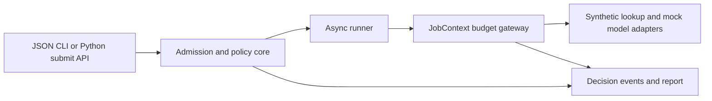

# agent-budget-scheduler: proposed MVP

Planning snapshot: 2026-10-07. Main independently accepted M1/M2 and assigned M3 on the same date. The planned local MVP is implemented for final whole-repository review; [EVIDENCE.md](EVIDENCE.md) records executed checks and unexecuted hosted CI. Milestone text below preserves the accepted scope and review boundaries.

Repository: `C:/Users/shash/Documents/CodexPortfolios/agentic-ai-2026-10-07/agent-budget-scheduler`.

## Problem and user journey

A developer runs several agent jobs for different teams in one Python process. A flood of jobs can occupy every slot, a strict priority queue can delay another team's work indefinitely, and an agent loop can continue starting tools after consuming its allotted usage. A semaphore alone does not explain why a job was rejected, delayed, cancelled, or stopped. Post-call token logs do not prevent concurrent calls from spending the same remaining reservation.

Build a small embeddable scheduler with a CLI that demonstrates admission, fair dispatch, guarded tool calls, and an inspectable usage ledger. A platform engineer can put an existing cooperative async agent callback behind the Python API, or run synthetic workloads to assess the scheduling rules before integration.

The practical offline journey will be:

1. Run `py -3.11 -m agent_budget_scheduler run examples/basic.json --out work/basic` from the repository root. No installation, credentials, network connection, or model download is needed.
2. Inspect a concise terminal summary, `work/basic/report.json`, and `work/basic/events.jsonl`. The report identifies `execution_mode: offline_mock` and separates submitted estimates, granted reservations, observed mock usage, and mock-reported cost.
3. Run overload, budget, fairness, deadline, and cancellation examples. Read the exact rejection or stop reason and the operation that consumed or attempted to reserve the remaining budget.
4. Use `py -3.11 -m examples.embedded_agent` to see the same scheduler manage a custom async callback with a synthetic lookup connector and mock model connector.

The CLI performs fresh local scheduler execution using mock agents. It is not recorded replay, model evaluation, a provider benchmark, or a virtual-time simulation. Timestamps may vary between runs; terminal states, counters, and controlled dispatch assertions must be reproducible.

## Existing tools and contribution

| Existing capability | Overlap and scoped decision |
| --- | --- |
| [Python asyncio](https://docs.python.org/3.11/library/asyncio-task.html) | Supplies task execution and cooperative cancellation/timeouts. Use these primitives and add the queue policy, admission rules, per-job ledger, and decision evidence. Cancellation may be delayed or suppressed by callbacks; retain capacity until owned work ends. |
| [APScheduler 3.x user guide](https://apscheduler.readthedocs.io/en/3.x/userguide.html) | Already supports scheduling, per-job instance limits, misfire handling, and events. This MVP concerns submitted agent workloads and guarded operation budgets; recurring calendar scheduling is outside its scope. |
| [Celery 5.6.2 worker guide](https://docs.celeryq.dev/en/v5.6.2/userguide/workers.html) | Already offers worker concurrency, revocation, and time limits. Broker-based distributed execution is unnecessary for the bounded, embeddable local use case. |
| [LiteLLM budgets and rate limits](https://docs.litellm.ai/docs/proxy/users) | Already offers LLM gateway budgets and rate controls, including agent/session controls. The contribution here is an executable job-dispatch policy with cancellation/deadline evidence and a tool-operation ledger. A production LLM gateway can remain a separate enforcement layer. |

The original contribution is the compact combination and its inspectable contract: tenant dispatch fairness, aging priority, bounded admission, truthful unknown-usage accounting, and failure fixtures that exercise the same scheduler used by the API. Round robin, aging, reservations, and cancellation are established techniques. There is no claim that these algorithms or agent budgeting are novel, and no comparative performance claim.

## Narrow MVP and non-goals

Included:

- A single-process, single-event-loop Python library and JSON-workload CLI.
- Global running-job capacity and a configured per-tenant running-job capacity.
- A bounded pending queue with immediate overload rejection and no implicit eviction.
- Integer priorities 0 through 9, tenant round robin, and priority aging within a tenant.
- Relative job deadlines that include queue wait, using a monotonic clock.
- Queued cancellation and cooperative running cancellation with explicit stop reasons.
- Per-job maximum started guarded tool calls and total-token reservation budgets.
- An adapter interface, two safe built-in mock connectors, and an embeddable callback example.
- JSONL decision events, a JSON summary, CLI reports, and tests for important failure cases.

Non-goals:

- Distributed workers, persistence/restart recovery, brokers, databases, HTTP servers, dashboards, automatic retries, DAGs, cron schedules, or dependencies between jobs.
- CPU/GPU/memory measurement or allocation, forced preemption, operating-system isolation, execution of untrusted scripts, or killing arbitrary threads/processes.
- Live provider SDKs, MCP/A2A integration, credentials, tokenizer/model downloads, provider price catalogs, recorded replay, and live model evaluation.
- Weighted tenant shares, optimization for job length or deadlines, earliest-deadline-first scheduling, or fairness by CPU time/token consumption.
- A hard monetary spending cap, exactly-once external effects, external rollback on cancellation, or an unconditional hard token-consumption cap for arbitrary adapters.

## Architecture and concrete contracts

Use **CPython 3.11.9** for the documented reference commands and CI. It is already present via `py -3.11`. The default `python` command instead resolves to 3.12.7, and another existing uv-managed interpreter is 3.11.16; do not silently use the default command when gathering reference evidence. No runtime or test dependencies are required. Use `asyncio`, dataclasses, enums, JSON, Decimal, argparse, time, pathlib, and unittest from the standard library. Java 17 is available, but a Java implementation would need either a JSON dependency/build wrapper or a less useful input format. Python provides a practical integration API for async agent/tool harnesses without that infrastructure.

The package is directly runnable from a clone. PyPI packaging and build-backend dependencies are deferred. The project version starts at 0.1.0; its own workload, event, and report formats are pinned to `schema_version: "1.0"`. They are local contracts, not an implementation of a third-party agent protocol. Unknown schema versions and unknown input fields fail validation before any workload starts.



Proposed modules: `models.py` for validated contracts, `policy.py` for deterministic dispatch/state transitions, `budget.py` for reservations/reconciliation, `scheduler.py` for async execution/lifecycle, `mock.py` for safe adapters and scripted agents, and `__main__.py`/`report.py` for CLI/output. Keep the policy core synchronous with an injected monotonic clock. Mutable state transitions run on one event loop and do not await between checking and updating capacity or budget. The runner owns and drains dispatched tasks and guarded operation tasks. This permits deterministic policy tests and small real-async integration tests without a second scheduling engine.

### Admission, lifecycle, and deadlines

- A job carries a unique ID, tenant, priority, optional positive `deadline_after_ms`, call/token limits, and optional estimated tokens/duration/cost. Estimates are report inputs, not substitutes for measured usage or budget bounds.
- Configure `max_running`, `max_running_per_tenant`, `max_pending`, and `aging_interval_ms`; capacities and aging interval must be positive integers. Token/call limits may be zero. Reject booleans masquerading as integers, negative counts, nonfinite values, duplicates, and oversized workloads. Bound a CLI manifest to 1 MiB, 1,000 jobs, 100 scripted operations per job, and 10,000 scripted operations overall; these are input limits, not a benchmark capacity claim.
- `max_pending` counts queued jobs, excluding running jobs. A full queue returns a rejection receipt immediately with `reason: overload`; high priority does not evict accepted work. The receipt distinguishes rejected submission from an accepted job that later fails.
- States: `QUEUED`, `RUNNING`, `STOPPING`, then one immutable terminal state: `SUCCEEDED`, `CANCELLED`, `DEADLINE_EXCEEDED`, `BUDGET_EXHAUSTED`, or `FAILED`. Reports include rejected admission receipts separately. Stop requests latch the first processed reason; later diagnostic events cannot rewrite the terminal outcome.
- Compute each deadline from submission time, not start time. At `now >= deadline`, a queued job expires without running a tool. Check deadlines before dispatch, before each guarded call, and at completion; a late completion cannot become success.
- Queued cancellation removes the job without invoking its callback. Running cancellation requests cancellation, prevents further guarded calls, and retains its slot while callback/tool cleanup runs. A deadline uses the same stop path with its own reason. Repeated cancellation is idempotent and does not create a second terminal event.
- An adapter or callback error fails its own job while unrelated jobs continue. No automatic retries. Closing the scheduler stops accepting work and drains/cancels owned tasks according to the documented close contract.

### Fairness and priorities

Choose the next tenant with pending eligible work by round robin, skipping tenants at their running limit. Rotate after an actual dispatch. Within that tenant select the largest effective priority:

`effective_priority = min(9, base_priority + floor(queued_wait_ms / aging_interval_ms))`.

Break ties by earliest enqueue sequence. A deadline is an expiry constraint; it does not override tenant fairness. New tenants join the ring at the tail. Accepted work is nonpreemptive. A high-priority job in one tenant can wait behind another tenant's low-priority job; this is deliberate and documented.

For a fixed finite set of continuously eligible tenants, each gets a dispatch opportunity within one rotation. An older low-priority job eventually reaches priority 9 and wins ties against later jobs in its tenant. These are dispatch guarantees conditional on jobs releasing slots and remaining eligible, not guarantees of latency, deadline satisfaction, CPU-time fairness, or equal token use. No tenant can make progress when all required slots remain occupied by noncooperative work.

### Tool and token budgets

All supported operations go through `JobContext.call(...)`; the mock model is a registered tool named `model.generate`. Thus `max_tool_calls` counts every started guarded operation, including model generation, failures, and subsequently cancelled calls. Provider-internal tools and bypassed external calls are not magically counted.

Before invocation, atomically check the job state/deadline, increment the started-call counter, and reserve the operation's declared maximum total tokens. Denied calls do not invoke the adapter and do not increment started usage. Zero-token lookup calls still consume a call slot. Allow a second guarded operation to proceed concurrently only if its reservation also fits; tests must demonstrate that two calls cannot both spend the same remaining budget.

Maintain separate fields for observed known tokens, active reserved tokens, and unresolved reserved tokens. Admission of another operation requires:

`observed_known_tokens + active_reserved_tokens + unresolved_reserved_tokens + new_reservation <= max_tokens`.

On a successful usage-bearing result, record input/output/total usage and release the unused reservation. Validate nonnegative integer usage and arithmetic consistency. If actual reported tokens exceed the reservation, record the full observed amount, flag the contract breach/overrun, fail the job, and deny later calls; never clamp usage to make a budget appear satisfied. If an operation started but fails or is interrupted without trustworthy usage, mark that usage unknown and retain its full reservation conservatively. Unknown is not zero and not observed consumption. The report must expose incomplete usage and any overrun.

An adapter must declare what its bound covers. The built-in mock honors the declared bound except for the intentional fault fixture. Arbitrary integration callbacks and adapters are trusted cooperative code and may bypass the API or misreport usage. The scheduler enforces its dispatch/reservation contract, and only controls calls through its gateway. It cannot claim a hard consumption cap for such adapters or undo an external side effect.

The [official OpenAI Responses reference](https://developers.openai.com/api/reference/python/resources/responses/methods/create) distinguishes a generated-output bound (including reasoning tokens), built-in-tool limits, and response usage fields. This motivates keeping adapter-specific bounds separate from observed total-token accounting. It is research context only; no OpenAI API support or compatibility version is claimed in this MVP.

### Estimates, observed cost, and evidence

Keep submitted estimates under `estimates`, independent of `usage`. Report known observed tokens, started calls, active/unresolved reservations, remaining conservative allowance, queue wait, runtime, and any unknown measurements. Include numeric limits and the rejected reservation in budget-stop events.

Cost fields use decimal strings and explicit currency/source. An optional adapter-reported cost is a report input, not an invoice inferred from tokens. The mock emits clearly labeled `source: synthetic_mock` costs. Aggregate a complete reported cost only when every started operation supplies compatible cost data; otherwise show a known subtotal and incomplete/null total. Missing cost is not zero. No monetary cap configuration or provider-price calculation is included.

Events include schema version, sequence, monotonic elapsed time, job/tenant ID, event type, state, reason, and applicable counters/reservations. Include admission, rejection, dispatch with effective priority, stop request, operation start/result/unknown usage, and terminal events. Store synthetic IDs and summaries, not arbitrary prompts, secrets, tool payloads, or stack-local values. Decision events support diagnosis; they are not a durable transactional audit log.

## Bounded milestones

### M1: first runnable end-to-end slice

Implement the validated local contracts, capacity/admission core, tenant selection, async runner, call/token ledger, two mock adapters, CLI, `examples/basic.json`, and API embedding example. Deliver a README quickstart and initial main-path tests. The basic fixture has two tenants/jobs, two guarded operations each, and known mock usage of 40 and 25 tokens. Its report must show two successes, four started calls, 65 observed tokens, no unknown usage, and no limit violations. Main explicitly authorized this milestone; stop for slice review before M2.

### M2: required failure and fairness cases

Add aging, deadlines, cancellation, overload fixtures, unknown-usage/overrun handling, robust cleanup, and focused tests. Fixtures cover a full queue, exhausted call budget, a token reservation that does not fit, queued/running deadline expiry, queued/running cancellation, connector failure, missing usage, and adapter usage above its declared reservation. The fairness fixture uses global concurrency 1 and three tenants with stable queued work; expect dispatch tenants `alpha, beta, gamma, alpha, alpha`. An injected-clock test separately demonstrates aging against later high-priority arrivals. Do not broaden to distributed execution or a live provider.

### M3: docs, CI, attribution, and evidence

Finish `docs/ARCHITECTURE.md`, `docs/CONTRACTS.md`, `docs/LIMITATIONS.md`, `docs/RESEARCH.md`, MIT `LICENSE`, `THIRD_PARTY_NOTICES.md`, reproducible examples, and `EVIDENCE.md`. Add CI on `ubuntu-24.04` and `windows-2022` with Python 3.11.9, standard-library tests, and CLI smoke checks, without secrets or paid calls. Record local commands, their observed results, interpreter version, and unexecuted remote/platform checks. Main independently executes acceptance; acceptance failures return to this worker in a bounded follow-up.

Planning and the bounded standard-library unit suite require no heavy lease. A later large install, integration run, or unexpected resource-heavy operation needs a named main-issued lease. Do not modify the main-owned resource record.

## Tests and acceptance

Tests check behavior/invariants, not just helper implementation details:

| Case | Required assertion |
| --- | --- |
| Basic workload/API | Both jobs finish; usage is 65 and started calls are 4; estimates remain the submitted values. |
| Concurrent capacity | Event-controlled callbacks show global and per-tenant active counts never exceed configured limits, including while cancellation cleanup is blocked. |
| Overload | With two pending slots, the third simultaneous pending submission is rejected; its adapter is never invoked. |
| Tenant fairness | With one running slot and a fixed eligible ring, dispatch is alpha/beta/gamma/alpha/alpha despite alpha's initial backlog. |
| Priority aging | A queued priority-0 job eventually wins a tie at effective priority 9 over later priority-9 jobs; earlier high priority wins before aging. |
| Tool exhaustion | With a limit of 1, the first call starts and the second is denied; adapter invocation count stays 1, terminal reason identifies calls. |
| Token exhaustion | After observing 40 tokens against limit 50, a reservation of 11 is denied before invocation. |
| Concurrent reservations | Two operations competing for 60-token reservations against a 100-token allowance cannot both start while the first reservation remains active. |
| Usage integrity | Above-bound usage is retained in full and fails the job; malformed/missing usage cannot silently become zero or a successful complete measurement. |
| Cancellation/deadline | Queued work never starts after cancellation/expiry; running work enters STOPPING, invokes cleanup, starts no later tool, and releases capacity only after draining. |
| Lifecycle races | Completion versus cancel/expiry follows the serialized stop/deadline rules and emits exactly one terminal event; repeated cancellation is harmless. |
| Failure isolation | A failing connector stops its job and keeps started usage; another queued job still runs. |
| Cost truthfulness | Estimated cost, mock-reported cost, and unknown cost remain separate; unknown total is null, not zero. |
| Input/CLI/report | Unsupported schemas, invalid counts, duplicate IDs, unknown tools/fields fail before tools run; CLI exit code and JSON structures match documented contracts. |

Core tests use an injected clock. Async tests use `unittest.IsolatedAsyncioTestCase` with Events/barriers for ordering and cleanup, with short outer timeouts to fail hangs. Only the CLI demonstrations use short mock delays; avoid asserting exact real-time durations. Add a small bounded, seeded randomized core test for queue/running counts, nonnegative reservations, no post-terminal dispatch, and immutable terminal results; no benchmark or external property-test dependency is needed.

Planned acceptance commands (see EVIDENCE.md for commands now executed through M3; `scripts/check_examples.py` verifies all seven scenarios):

```powershell
Set-Location 'C:\Users\shash\Documents\CodexPortfolios\agentic-ai-2026-10-07\agent-budget-scheduler'
py -3.11 --version
py -3.11 -m unittest discover -s tests -v
py -3.11 -m agent_budget_scheduler run examples/basic.json --out work/basic
py -3.11 -m agent_budget_scheduler run examples/fairness.json --out work/fairness
py -3.11 -m agent_budget_scheduler run examples/overload.json --out work/overload
py -3.11 -m agent_budget_scheduler run examples/budgets.json --out work/budgets
py -3.11 -m agent_budget_scheduler run examples/lifecycle.json --out work/lifecycle
py -3.11 -m examples.embedded_agent
py -3.11 -m unittest tests.test_cli -v
git diff --check
```

CLI contract: exit 0 when a valid workload is fully processed, including expected rejection/failure scenarios; exit 2 for invalid input; exit 1 for runner/output failure. Scenario outcome counts are reported explicitly. `tests.test_cli` must execute the public CLI in subprocesses and independently assert basic counts, fairness order, an overload rejection with no operation start, both budget-exhaustion reasons, lifecycle terminal states, and accurate `offline_mock` labeling. Each invocation writes parseable schema-1.0 JSON/JSONL. The basic CLI's known usage assertions are `observed_known_tokens == 65`, `started_tool_calls == 4`, and both accepted jobs `SUCCEEDED`.

Acceptance also requires the README journey to work in a clone without pip installs, no model/network calls in tests, documented limitations, all promised examples, MIT source license plus runtime/CI attribution, and an evidence report that separates actually run local checks from unexecuted hosted CI/live provider checks. No claimed test count or result exists at planning time.

## Pinned versions, artifact checks, and research record

All sources below were actually opened/read on **2026-10-07**, rather than relying solely on search snippets. References are current at retrieval; they are not a guarantee of future availability.

| Component/reference | Pin or snapshot | Availability, license, and use |
| --- | --- | --- |
| [CPython release](https://www.python.org/downloads/release/python-3119/) | 3.11.9 | Official page lists Windows installers, embeddable packages, and source archives; the installed interpreter was verified locally. No download needed. This is a reproducibility baseline, not a claim that it is the newest Python patch. |
| [CPython tagged license](https://raw.githubusercontent.com/python/cpython/v3.11.9/LICENSE) | v3.11.9 | PSF License Version 2 with historical/incorporated license notices. Runtime is not vendored. Record runtime attribution and retain third-party notices if anything is later redistributed. |
| [Asyncio documentation](https://docs.python.org/3.11/library/asyncio-task.html) and [tagged task source](https://raw.githubusercontent.com/python/cpython/v3.11.9/Lib/asyncio/tasks.py) | Python 3.11 docs; v3.11.9 source | Read cancellation semantics and task cleanup behavior. No copied implementation. |
| [APScheduler guide](https://apscheduler.readthedocs.io/en/3.x/userguide.html) and [artifact metadata](https://pypi.org/project/APScheduler/3.11.3/) | Comparison: 3.11.3; rolling 3.x docs reported 3.11.3.post3 | PyPI lists wheel/sdist and MIT license. Comparison only; not installed or a dependency. |
| [Celery worker guide](https://docs.celeryq.dev/en/v5.6.2/userguide/workers.html) and [artifact metadata](https://pypi.org/project/celery/5.6.2/) | Comparison: 5.6.2 | Versioned docs read; PyPI release/artifact page and BSD-3-Clause metadata read. The page reports a newer 5.6.3 release, so do not describe 5.6.2 as latest. Not a dependency. |
| [LiteLLM budget docs](https://docs.litellm.ai/docs/proxy/users) | Unversioned documentation snapshot, 2026-10-07 | Read existing budget/rate-limit/session controls and database requirements. No package/artifact chosen, installed, or copied; no compatibility claim. |
| [OpenAI Responses Python reference](https://developers.openai.com/api/reference/python/resources/responses/methods/create) | Unversioned API documentation snapshot, 2026-10-07 | Read output/tool bounds and observed usage fields. Research context only; no SDK, model pin, credential, paid call, or API integration. The first attempted generic create route returned an error; the corrected language-specific route was opened successfully. |
| [checkout tag API](https://api.github.com/repos/actions/checkout/git/ref/tags/v4.3.0), [license](https://raw.githubusercontent.com/actions/checkout/v4.3.0/LICENSE), and [pinned action manifest](https://raw.githubusercontent.com/actions/checkout/08eba0b27e820071cde6df949e0beb9ba4906955/action.yml) | v4.3.0 / `08eba0b27e820071cde6df949e0beb9ba4906955` | GitHub ref resolves to a commit; license reads MIT; manifest uses Node 20. CI-only, not a local runtime dependency. |
| [setup-python tag API](https://api.github.com/repos/actions/setup-python/git/ref/tags/v6.0.0), [license](https://raw.githubusercontent.com/actions/setup-python/v6.0.0/LICENSE), and [pinned action manifest](https://raw.githubusercontent.com/actions/setup-python/e797f83bcb11b83ae66e0230d6156d7c80228e7c/action.yml) | v6.0.0 / `e797f83bcb11b83ae66e0230d6156d7c80228e7c` | GitHub ref resolves to a commit; license reads MIT; manifest uses Node 24. Use hosted runner images compatible with that action. Hosted workflow execution remains unverified until publication is separately authorized. |

No third-party runtime/test wheels, Java artifacts, native binaries, protocol SDKs, services, or containers are selected. The local formats are the only protocol contracts to pin. MIT is proposed for this repository's original code and synthetic fixtures.

## Risks and decisions for main

- **Cooperative execution:** Blocking or cancellation-suppressing callbacks can delay deadlines, shutdown, and slot release. Document this boundary and prove slot accounting with a finite cleanup-delay test. Process isolation is deferred.
- **Unknown/incorrect telemetry:** Interrupted calls may already have consumed tokens or caused side effects. Conservative unresolved reservations and truthful overrun flags reduce accounting mistakes but cannot manufacture missing measurements.
- **Fairness scope:** Tenant round robin treats a long job and short job as one dispatch each. This is appropriate for an explainable small scheduler; service-time/token fairness and performance optimization are deferred.
- **Reproducibility:** Validate deterministic states/counters with clock injection and event barriers; do not promise identical timestamps or a wall-clock benchmark.
- **Bounded memory:** Limit pending submissions and input sizes; result/event history is intended for bounded runs, not an unbounded daemon. Streaming/rotation/retention storage is deferred and documented.
- **API integration:** Code using the embeddable API is trusted and must route relevant operations through JobContext. This is not a security sandbox or complete-account spending controller.

Routine decisions are resolved: Python 3.11.9, standard library only, single process, relative deadlines, round robin plus aging, fresh offline mocks, MIT, and no live adapter. There are no essential human-input blockers. Main independently accepted M1/M2 and explicitly assigned M3. Final local delivery stops for independent whole-repository acceptance; later corrections remain bounded by this plan and main's assignment.

## Planning evidence

Read repository `AGENTS.md`, own `assignment.txt`/`status.json`, human `coordination/user-request.txt`, and main-owned `coordination/resources.json` without editing shared records. `rg --files` found only AGENTS.md. `git status --short` showed untracked AGENTS.md; `git log -1 --oneline` reported no commits on initial main. Interpreter commands established Python 3.11.9/3.11.16/3.12.7 and Java 17.0.18. Read the sources and CI tag/license manifests listed above. No implementation, tests, demo, dependency install, heavy build, paid call, publication, deployment, or external account change has occurred.
