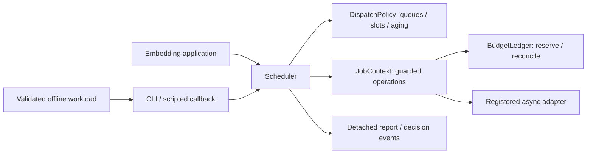
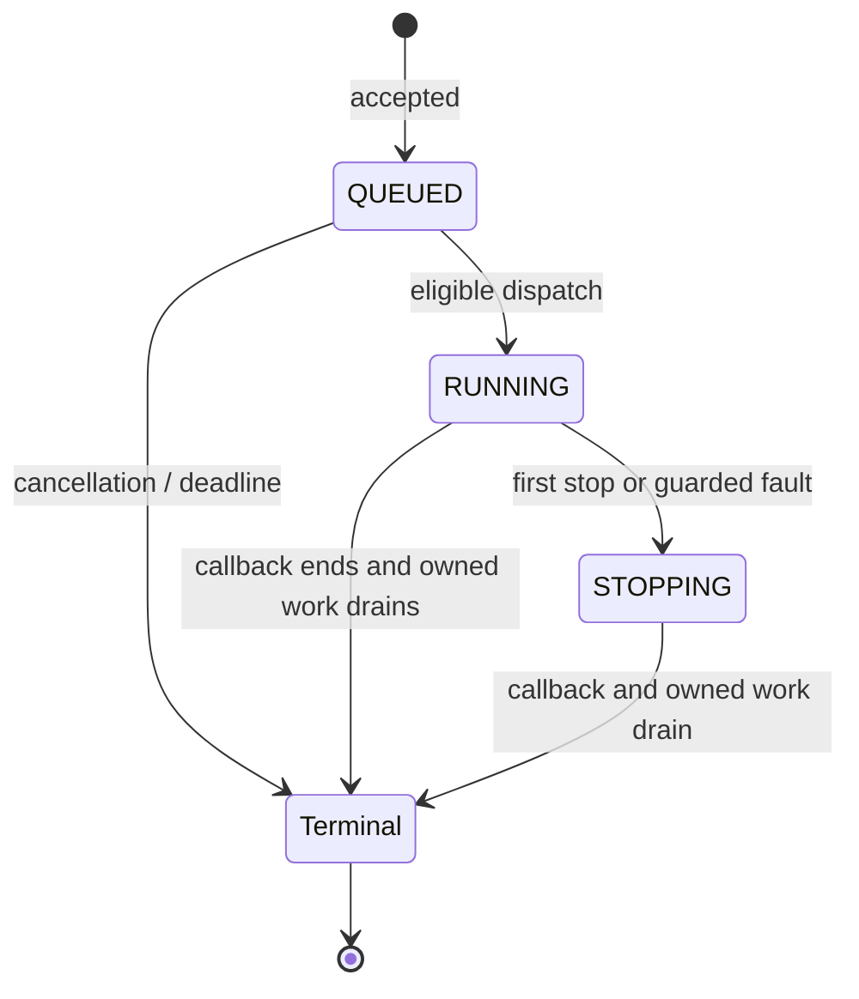

# Architecture

This is an embeddable, single-process scheduler for bounded runs of trusted async callbacks. The same Python API serves the offline CLI and the embedding example. There is no service, broker, database, provider SDK, background daemon, or runtime package dependency.

## Components and ownership

`models.py` defines the input, result, state, and schema-1.0 contracts. `policy.py` owns synchronous admission and state transitions. `scheduler.py` owns one event loop, accepted-job completion futures, callback tasks, deadline timers, and events. Each context owns its dispatched operation tasks through reconciliation. `budget.py` tracks each job's call slots, known tokens, active reservations, unresolved reservations, and explicitly sourced cost. `mock.py` provides fictional connectors and complete manifest validation; `__main__.py` writes the final JSON/JSONL.

Admission, slot changes, and reservation checks contain no await. Two concurrent guarded calls therefore cannot both spend the same remaining reservation allowance. The adapter mapping is copied at construction. Tool arguments are copied into a shallow read-only mapping before invocation; nested values remain ordinary caller objects. The API must be used on its owning event loop, with submission inside its async context.

## Lifecycle and cleanup

Terminal states are SUCCEEDED, FAILED, BUDGET_EXHAUSTED, CANCELLED, and DEADLINE_EXCEEDED. Rejected admission has no job record, callback, or ledger. Queued stops publish immediately without invoking the callback. RUNNING and STOPPING both occupy a global and tenant slot. A stop latches its first state/reason; later requests cannot change it. A running stop can deliver one scheduler cancellation to an entered callback. A stopped task that has not entered instead checks its stop state before calling the agent.

The context tracks operation tasks including their ledger reconciliation. On callback exit, unfinished owned work causes `unawaited_operations`, is cancelled, and is drained under a shield before the job releases capacity. Interrupted operations without telemetry become unresolved reservations, including cancellation before adapter entry. Ordinary job/adapter faults become outcomes and leave unrelated jobs eligible. Caller-created tasks outside the context are not owned.

Deadline time starts at admission, using a monotonic clock. The scheduler arms the nearest outstanding deadline and also checks expiry before submission/dispatch, cancellation, guarded calls, and completion. Injected-clock tests call `poll()` after advancing time. Cleanup may finish after the deadline; cooperative execution does not impose a hard completion time.

## Dispatch and reporting

Each successful dispatch rotates the tenant ring past the selected tenant. Empty or tenant-capped queues are skipped. Within that tenant, selection uses effective priority descending and enqueue sequence ascending. Effective priority is `min(9, base_priority + floor(wait_ms / aging_interval_ms))`. Jobs at or past their deadline cannot dispatch. Running jobs are never preempted to favor a newly arrived job.

The report contains submitted estimates beside observations. Events record decisions rather than payloads. All history remains in memory; output files are ordinary final snapshots, not a durable journal or replay protocol. See [CONTRACTS.md](CONTRACTS.md) for exact fields and [LIMITATIONS.md](LIMITATIONS.md) for the execution boundary.

## Verification boundary

Controlled async tests measure actual callback concurrency and deliberately hold cleanup gates. Fake-clock tests establish deadline and aging boundaries. A bounded seeded core sweep checks independent queue/running bookkeeping, reservation accounting, no terminal redispatch, and stable terminal records across subsequent transitions. CLI checks assert literal seven-fixture results. These establish local invariants and failure behavior; they do not establish provider compatibility, throughput, security isolation, or distributed guarantees.
